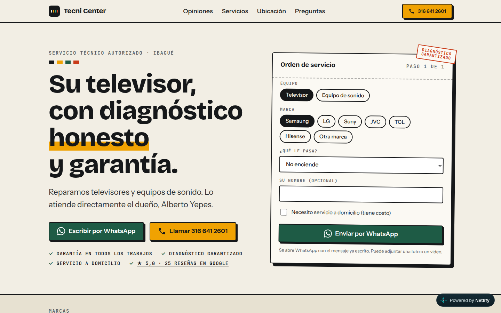
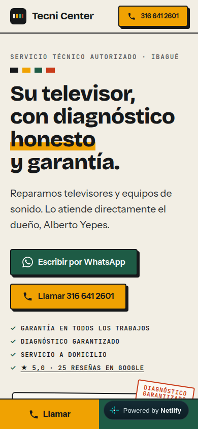

# Tecni Center — sitio web para un taller de reparación de TV y sonido

Sitio estático para **Tecni Center**, un taller de servicio técnico de televisores y equipos de sonido en Ibagué (Tolima, Colombia), atendido por su único dueño. El objetivo es convertir las búsquedas locales en **chats de WhatsApp y llamadas**.

**En vivo:** https://tecnicenter.netlify.app

| Escritorio | Móvil |
| --- | --- |
|  |  |

> Este repositorio es una muestra de portafolio. El código está visible para que se pueda leer, no para reutilizarlo: no incluye licencia de reutilización. Los textos, la marca y los datos del negocio pertenecen a Tecni Center.

## El problema

El negocio ya aparecía en Google (ficha con 5,0 de calificación y 25 reseñas) y recibía búsquedas como "televisor" y "samsung", pero **no tenía sitio web**: no había a dónde llevar a quien buscaba, ni un canal de contacto directo, ni páginas legales, ni medición.

## Qué se hizo

**1. Investigación comercial.** Se revisó la ficha de Google, Waze y las reseñas reales para sacar el público (hogares con un TV dañado, sobre todo Samsung), su miedo principal (que le cobren de más o no se lo arreglen) y la prueba que lo desactiva: las reseñas repiten "honestidad" y "garantía".

**2. Dirección de arte: "La orden de servicio".** La web se parece al comprobante de un taller: papel, tinta, ámbar de soldadura y verde de placa electrónica. Las bandas de colores de una resistencia se repiten como motivo. Tipografías: Bricolage Grotesque, Instrument Sans y JetBrains Mono, autoalojadas.

**3. Conversión.**
- En el hero hay una **orden de servicio interactiva**: el cliente elige equipo, marca y falla, y el mensaje de WhatsApp se escribe solo (`wa.me` con texto codificado). Sin JavaScript, el botón sigue abriendo WhatsApp con un mensaje genérico.
- Botones de **WhatsApp y llamada** en el hero, en el cierre y en una barra fija en móvil.
- Reseñas reales con las palabras exactas de los clientes y enlace directo al formulario de reseña de Google.
- Sin precios inventados, sin testimonios ni cifras que no existan.

**4. SEO local.** `ElectronicsStore` en JSON-LD con dirección, coordenadas y horario; `FAQPage` en JSON-LD; sitemap, `robots.txt`, URL canónica, Open Graph. No se publicó `aggregateRating`: Google ignora las valoraciones propias en datos estructurados.

**5. Aspectos legales (Colombia).** Política de tratamiento de datos (Ley 1581 de 2012), cookies, términos de uso y garantía (Ley 1480 de 2011). Son plantillas y deben ser revisadas por un abogado.

**6. Privacidad y medición.** Google Analytics 4 se carga **solo después de que el visitante acepta** el banner de cookies; antes no sale ninguna petición a Google. El mapa también es de carga manual. Se mide el evento `contact_click` (llamadas, WhatsApp, indicaciones, reseñas).

**7. Seguridad.** Cabeceras en `public/_headers`: CSP, HSTS, `X-Frame-Options: DENY`, `nosniff`, `Referrer-Policy` y `Permissions-Policy`. Sin backend, sin formularios y sin secretos en el código.

## Stack

- **[Astro](https://astro.build)**, salida estática, CSS propio y casi nada de JavaScript.
- **Netlify** para el hosting.
- Por qué: la mayoría de las visitas llegan desde Google en un celular. Una web estática carga rápido y no tiene servidor que mantener.

## Resultados medidos

Lighthouse móvil sobre producción (2026-10-26): **rendimiento 99, accesibilidad 100, buenas prácticas 100, SEO 100**. Probado en Chrome a 390 px y 1440 px, sin errores de consola ni desbordes.

Sin probar: los botones de llamada y WhatsApp en un celular real.

## Estructura

```
src/
  data/site.ts          Datos del negocio, reseñas, marcas y preguntas frecuentes
  data/brand-logos.json Rutas SVG de los logos (Simple Icons)
  components/           Ticket (orden de servicio), banner de cookies, iconos
  layouts/              Base (head, header, footer) y Legal
  pages/                Inicio, páginas legales, 404 y robots.txt
  styles/global.css     Sistema de diseño
public/                 Favicon, imagen Open Graph, cabeceras de seguridad
```

Para cambiar teléfono, horario, reseñas o preguntas, basta con editar `src/data/site.ts`.

## Cómo correrlo

```bash
npm install
npm run dev      # http://localhost:4321
npm run build    # genera dist/
```

## Variables de entorno

Ninguna es secreta: Astro solo expone al navegador las que empiezan por `PUBLIC_`. Se configuran en Netlify (Site configuration → Environment variables); el archivo `.env` está en `.gitignore`.

| Variable | Para qué | Obligatoria |
| --- | --- | --- |
| `PUBLIC_GA_ID` | ID de medición de GA4 (`G-…`). Sin ella, no se carga Analytics. | No |
| `PUBLIC_GSC_VERIFICATION` | Valor de la etiqueta HTML de Search Console. | No |
| `SITE_URL` | Dominio propio, cuando se conecte uno. Por defecto se usa la URL de Netlify. | No |

Copia `.env.example` a `.env` para trabajar en local.

## Despliegue

```bash
npx netlify login
npm run deploy   # lee PUBLIC_GA_ID de Netlify, compila y publica en producción
```

El despliegue se hace desde la línea de comandos del dueño del proyecto, así que un pull request de un tercero **no publica nada**.


## Créditos

- Logos de marcas: [Simple Icons](https://simpleicons.org) (CC0). Las marcas pertenecen a sus titulares y se usan para identificar los equipos que atiende el taller.
- Icono de teléfono: Material Design Icons (Apache 2.0).
- Tipografías: Bricolage Grotesque, Instrument Sans y JetBrains Mono (SIL OFL), vía Fontsource.

Diseño y desarrollo: [@JeanCardozo](https://github.com/JeanCardozo).
